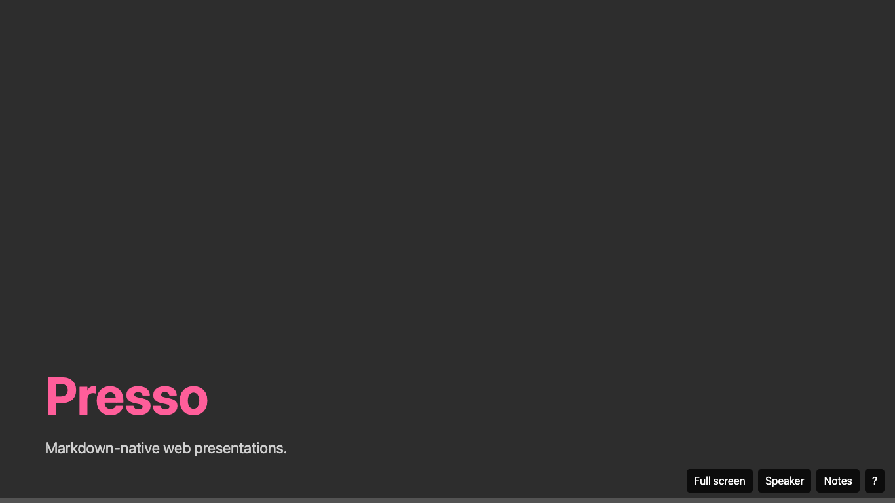

# @ajfisher/presso-create

Starter deck scaffolder for Presso.



Presso is a Markdown-native web presentation framework for talks, workshops, speaker notes, static publishing, and PDF export. `@ajfisher/presso-create` creates a new deck folder with numbered slide files, a local theme, npm scripts, and a dependency on the Presso CLI package.

## Quick Start

```bash
npm create presso@latest my-talk
cd my-talk
npm install
npm run dev
```

`create-presso` wraps this package for npm’s standard create command. The original
`npx @ajfisher/presso-create@latest my-talk` command and the `createDeck()` API remain supported.

The generated deck uses a `slides/` folder by default:

```text
my-talk/
  presso.config.ts
  theme.css
  slides/
  assets/
```

## Generated Scripts

- `npm run dev`: serve the deck locally with live browser routes.
- `npm run build`: write a static deck to `dist/`.
- `npm run pdf`: export slide PDFs.
- `npm run transcript`: export publishing-ready Markdown.
- `npm run deploy`: run the configured deploy command.

## Related Docs

- [Presso README](https://github.com/ajfisher/presso#readme)
- [Authoring format](https://github.com/ajfisher/presso/blob/main/docs/authoring-format.md)
- [Theme authoring](https://github.com/ajfisher/presso/blob/main/docs/theme-authoring.md)

